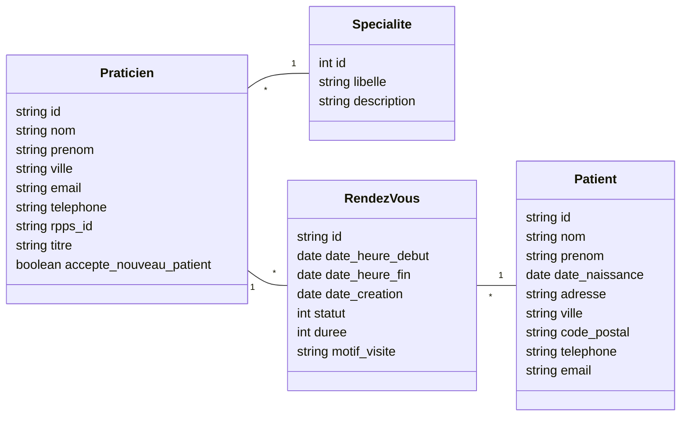

# Toubilib

Backend de gestion de rendez-vous médicaux, exposé sous forme d'API RESTful.
Projet fil rouge du module Développement Web Serveur avancé (BUT Informatique S5 – DWM, IUT Nancy-Charlemagne).

Stack : PHP 8.5, Slim 4, PHP-DI, PostgreSQL, Pest. Architecture hexagonale avec inversion de dépendances.

## Lancement

Prérequis : Docker et Docker Compose. Composer n'a pas besoin d'être installé sur la machine :
il tourne dans le conteneur PHP.

1. Créer les fichiers de configuration à partir des modèles :

   ```bash
   cp toubilib.env.dist toubilib.env
   cp app/config/.env.dist app/config/.env
   ```

   Dans `toubilib.env`, renseigner un utilisateur et un mot de passe Postgres
   identiques à `lib.username` et `lib.password` de `app/config/.env`, par exemple :

   ```
   POSTGRES_DB=toubilib
   POSTGRES_USER=user
   POSTGRES_PASSWORD=1234
   ```

2. Démarrer les services (le conteneur PHP exécute `composer install` au démarrage) :

   ```bash
   docker compose up -d --build
   ```

3. Créer la base et charger les données :

   ```bash
   docker compose exec toubilib.db psql -U user -d toubilib -f /var/sql/toubilib.schema.sql
   docker compose exec toubilib.db psql -U user -d toubilib -f /var/sql/toubilib.data.sql
   ```

| Service | URL |
|---|---|
| API | http://localhost:7080 |
| Adminer | http://localhost:8880 (serveur `toubilib.db`) |
| PostgreSQL | localhost:5532 |

Pour lancer Composer à la main : `docker compose exec api.toubilib composer install`.

## Tests

```bash
docker compose exec api.toubilib vendor/bin/pest
```

Les tests du domaine, du service et du DTO tournent sans base de données (repository en mémoire).
Les tests de `RendezVousRepository` nécessitent la base PostgreSQL démarrée.

## API

### Annuler un rendez-vous (fonctionnalité 6)

`PATCH /rdvs/{id}`

```json
{ "status": "annule" }
```

| Code | Cas |
|---|---|
| 200 | RDV annulé, le RDV est renvoyé en JSON |
| 400 | Corps de requête invalide |
| 404 | RDV introuvable |
| 409 | Annulation refusée : RDV passé, ou déjà annulé / honoré / ignoré |

Exemple :

```bash
curl -X PATCH http://localhost:7080/rdvs/<id> \
     -H "Content-Type: application/json" \
     -d '{"status": "annule"}'
```

Réponse :

```json
{
  "id": "…",
  "praticien_id": "…",
  "patient_id": "…",
  "date_heure_debut": "2026-12-05 11:30:00",
  "date_heure_fin": "2026-12-05 12:00:00",
  "date_creation": "2026-12-01 00:00:00",
  "duree": 30,
  "motif_visite": "CI",
  "status": 1,
  "status_libelle": "ANNULE"
}
```

Les RDV des données de départ sont tous passés. Pour tester une annulation réussie,
créer un RDV futur, par exemple :

```sql
INSERT INTO rdv (id, praticien_id, patient_id, date_heure_debut, status, duree, date_heure_fin, date_creation, motif_visite)
VALUES ('rdv-demo', '4305f5e9-be5a-4ccf-8792-7e07d7017363', 'da362a38-c1bf-39ed-8b2e-3bc99a86cfde',
        NOW() + INTERVAL '7 days', 0, 30, NOW() + INTERVAL '7 days 30 minutes', NOW(), 'CI');
```

Statuts d'un RDV : `0` prévu, `1` annulé, `2` honoré, `3` ignoré.

## Modèle du domaine



## Architecture et namespaces

Racine PSR-4 : `toubilib\` → `app/src/`

| Namespace | Rôle |
|---|---|
| `toubilib\domain\entities` | Entités métier (`RendezVous`, `RendezVousStatus`) et leurs règles |
| `toubilib\domain\exceptions` | Exceptions métier |
| `toubilib\application\ports\api` | Interfaces des services exposés (`ServiceRendezVousInterface`) |
| `toubilib\application\ports\spi` | Interfaces des dépendances externes (`RendezVousRepositoryInterface`) |
| `toubilib\application\usecases` | Services applicatifs (`ServiceRendezVous`) |
| `toubilib\application\dto` | DTO renvoyés par les services (`RendezVousDTO`) |
| `toubilib\adapters\persistence` | Adaptateurs de persistance PDO (`RendezVousRepository`) |
| `toubilib\adapters\controllers\actions` | Actions Slim |
| `toubilib\adapters\controllers\middlewares` | Middlewares et rendu JSON |
| `toubilib\adapters\config` | Configuration du conteneur d'injection de dépendances |
| `tests\` → `app/tests/` | Tests Pest |

Le domaine et l'application ne dépendent que des interfaces : les adaptateurs
sont branchés par le conteneur PHP-DI (`ContainerConfig`).

## Tableau de bord

| # | Fonctionnalité | État | Réalisé par |
|---|---|---|---|
| 1 | Lister les praticiens | À faire | |
| 2 | Détail d'un praticien | À faire | |
| 3 | Détail d'un RDV | À faire | |
| 4 | Agenda d'un praticien | À faire | |
| 5 | Créer un RDV | À faire | |
| 6 | Annuler un RDV | Fait (TD1) | |
| 7 | Créneaux occupés d'un praticien | À faire | |
