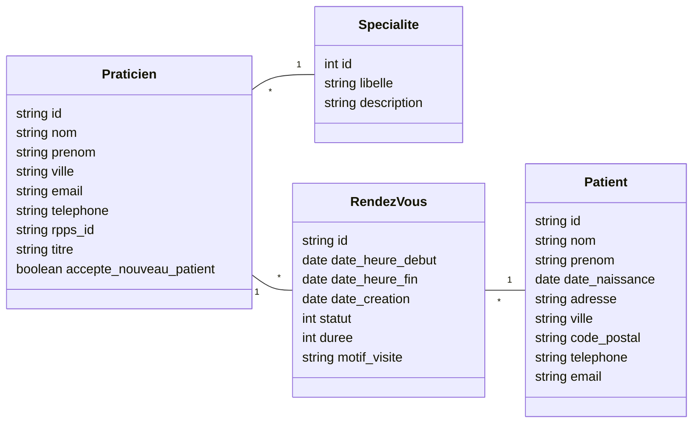

# Toubilib

Backend de gestion de rendez-vous médicaux, exposé sous forme d'API RESTful.
Projet fil rouge du module Développement Web Serveur avancé (BUT Informatique S5 – DWM, IUT Nancy-Charlemagne).

Stack : PHP 8.5, Slim 4, PHP-DI, PostgreSQL, Pest. Architecture hexagonale avec inversion de dépendances.

## Lancement

Prérequis : Docker et Docker Compose. Composer n'a pas besoin d'être installé sur la machine :
il tourne dans le conteneur PHP.

1. Créer les fichiers de configuration à partir des modèles :

   ```bash
   cp toubilib.env.dist toubilib.env
   cp app/config/.env.dist app/config/.env
   ```

   Dans `toubilib.env`, renseigner un utilisateur et un mot de passe Postgres
   identiques à `lib.username` et `lib.password` de `app/config/.env`, par exemple :

   ```
   POSTGRES_DB=toubilib
   POSTGRES_USER=user
   POSTGRES_PASSWORD=1234
   ```

2. Démarrer les services (le conteneur PHP exécute `composer install` au démarrage) :

   ```bash
   docker compose up -d --build
   ```

3. Créer la base et charger les données :

   ```bash
   docker compose exec toubilib.db psql -U user -d toubilib -f /var/sql/toubilib.schema.sql
   docker compose exec toubilib.db psql -U user -d toubilib -f /var/sql/toubilib.data.sql
   ```

| Service | URL |
|---|---|
| API | http://localhost:7080 |
| Adminer | http://localhost:8880 (serveur `toubilib.db`) |
| PostgreSQL | localhost:5532 |

Pour lancer Composer à la main : `docker compose exec api.toubilib composer install`.

## Tests

```bash
docker compose exec api.toubilib vendor/bin/pest
```

Les tests du domaine, du service et du DTO tournent sans base de données (repository en mémoire).
Les tests de `RendezVousRepository` nécessitent la base PostgreSQL démarrée.

### Tests de l'API avec Bruno

Le dossier `bruno/` contient une collection [Bruno](https://www.usebruno.com) avec une requête par route,
cas d'erreur compris, et des assertions sur les statuts de retour. Ouvrir le dossier dans Bruno et
choisir l'environnement `local` (API sur http://localhost:7080), ou en ligne de commande :

```bash
cd bruno
npx @usebruno/cli run --env local
```

## API

Toutes les réponses sont au format JSON. Les ressources sont accompagnées de liens HATEOAS (`links`).
Les headers CORS sont ajoutés à toutes les réponses (`CorsMiddleware`).

### Conception des routes (TD 1.4, exercice 1)

| Cas d'utilisation | Méthode et URI | Succès | Erreurs |
|---|---|---|---|
| Lister les praticiens | `GET /praticiens` | 200 | |
| Détail d'un praticien | `GET /praticiens/{id}` | 200 | 404 praticien inexistant |
| Créneaux occupés d'un praticien | `GET /praticiens/{id}/creneaux?debut=AAAA-MM-JJ&fin=AAAA-MM-JJ` | 200 | 400 période invalide, 404 praticien inexistant |
| Agenda d'un praticien sur une période | `GET /praticiens/{id}/rdvs?debut=AAAA-MM-JJ&fin=AAAA-MM-JJ` | 200 | 400 période invalide, 404 praticien inexistant |
| Détail d'un RDV | `GET /rdvs/{id}` | 200 | 404 RDV inexistant |
| Créer un RDV | `POST /rdvs` | 201 + header `Location` | 400 données invalides, 409 praticien indisponible |
| Annuler un RDV | `PATCH /rdvs/{id}/annuler` | 200 | 404 RDV inexistant, 409 RDV passé ou pas à l'état prévu |
| Honorer un RDV | `PATCH /rdvs/{id}/honorer` | 200 | 404 RDV inexistant, 409 RDV futur ou pas à l'état prévu |
| Ignorer un RDV | `PATCH /rdvs/{id}/ignorer` | 200 | 404 RDV inexistant, 409 RDV futur ou pas à l'état prévu |

Choix de conception :

- les agendas et créneaux sont des sous-ressources du praticien (`/praticiens/{id}/...`), la période
  est un filtre passé en paramètres d'URL ; sans paramètre, la période est la journée courante ;
- un RDV n'est jamais supprimé : annuler, honorer ou ignorer sont des changements d'état (`PATCH`),
  désignés par l'URL comme dans les liens HATEOAS de l'exemple du sujet ;
- `400` : requête invalide (données ou paramètres) ; `404` : la ressource de l'URL n'existe pas ;
  `409` : la requête est valide mais l'état de la ressource ne permet pas l'opération.

### Format des réponses

Une ressource, par exemple `GET /rdvs/2e1a7275-2593-3c04-9a4c-4e7cbada9541` :

```json
{
  "type": "ressource",
  "rendez_vous": {
    "id": "2e1a7275-2593-3c04-9a4c-4e7cbada9541",
    "praticien_id": "4305f5e9-be5a-4ccf-8792-7e07d7017363",
    "praticien_nom": "Cabinet Radio Plus",
    "patient_id": "5abcdbc4-90c9-3b86-82a3-c4cf1f7377d0",
    "patient_nom": "Marguerite Alves",
    "date_debut": "04/12/2025 18:30",
    "date_fin": "04/12/2025 18:50",
    "date_creation": "25/11/2025",
    "duree": 20,
    "motif_visite": "Consultation",
    "etat": "ANNULE"
  },
  "links": {
    "self": { "href": "/rdvs/2e1a7275-2593-3c04-9a4c-4e7cbada9541" },
    "praticien": { "href": "/praticiens/4305f5e9-be5a-4ccf-8792-7e07d7017363" },
    "patient": { "href": "/patients/5abcdbc4-90c9-3b86-82a3-c4cf1f7377d0" },
    "annuler": { "href": "/rdvs/2e1a7275-2593-3c04-9a4c-4e7cbada9541/annuler" },
    "honorer": { "href": "/rdvs/2e1a7275-2593-3c04-9a4c-4e7cbada9541/honorer" },
    "ignorer": { "href": "/rdvs/2e1a7275-2593-3c04-9a4c-4e7cbada9541/ignorer" }
  }
}
```

Une collection, par exemple `GET /praticiens/{id}/creneaux?debut=2025-12-05` :

```json
{
  "type": "collection",
  "count": 10,
  "periode": { "debut": "2025-12-05", "fin": "2025-12-05" },
  "creneaux": [
    { "date_debut": "05/12/2025 09:00", "date_fin": "05/12/2025 09:30" }
  ],
  "links": {
    "self": { "href": "/praticiens/4305f5e9-be5a-4ccf-8792-7e07d7017363/creneaux?debut=2025-12-05&fin=2025-12-05" },
    "praticien": { "href": "/praticiens/4305f5e9-be5a-4ccf-8792-7e07d7017363" }
  }
}
```

- `GET /praticiens` : collection `praticiens`, chaque praticien avec son lien `self` ;
- `GET /praticiens/{id}` : ressource `praticien` (titre, nom, prénom, spécialité, contacts, adresse)
  avec les liens `self`, `rdvs` (agenda) et `creneaux` ;
- `GET /praticiens/{id}/rdvs` : collection `rendez_vous` (horaires, patient, motif, état), chaque RDV
  avec son lien `self`, et les liens `self`, `praticien` et `creneaux`.

Les erreurs sont mises en forme par le gestionnaire d'erreurs par défaut de Slim :

```json
{
  "message": "404 Not Found",
  "exception": [
    {
      "type": "Slim\\Exception\\HttpNotFoundException",
      "code": 404,
      "message": "Rendez-vous b2dd56c2-700b-3b49-915d-d3be96f7f6a not found",
      "file": "...",
      "line": 32
    }
  ]
}
```

Le détail `exception` n'est affiché que si `displayErrorDetails` vaut `true` dans `app/config/settings.php`.

### Créer un rendez-vous (fonctionnalité 5)

`POST /rdvs`

```json
{
  "praticien_id": "4305f5e9-be5a-4ccf-8792-7e07d7017363",
  "patient_id": "da362a38-c1bf-39ed-8b2e-3bc99a86cfde",
  "date_heure_debut": "2030-01-08 14:00",
  "motif_visite": "CO"
}
```

Règles métier :

- motifs acceptés et durée du RDV : `CI` 30 min, `CO` 20 min, `CS` 15 min ;
- RDV du lundi au vendredi, entièrement compris entre 9h et 19h, et dans le futur ;
- le RDV ne doit chevaucher aucun RDV non annulé du praticien.

Traitement d'une demande :

1. `ValidationCreateRdvMiddleware` construit un `CreateRdvDTO` à partir du corps de la requête
   (`CreateRdvDTO::fromArray`) : suppression des espaces et balises, puis contrôle de la présence,
   du type et du format des champs avec Respect\Validation ;
2. `CreerRendezVousAction` appelle `ServiceRendezVous::creerRendezVous()` ;
3. le service valide les données avec `RdvValidator` (praticien et patient existants, motif, date),
   charge le patient et le praticien avec ses RDV du jour, crée l'entité avec `RendezVous::creer()`
   (motif, date, disponibilité) puis la sauvegarde avec `RendezVousRepository::ajouter()`.

### Cycle de vie d'un RDV

- annuler : RDV à l'état prévu et pas encore commencé ;
- honorer / ignorer : RDV à l'état prévu et déjà commencé.

Statuts d'un RDV : `0` prévu, `-1` annulé, `2` honoré, `3` ignoré (`-1` est la valeur utilisée par les données de départ).

Les RDV des données de départ sont tous passés. Pour tester une annulation réussie,
créer d'abord un RDV futur avec `POST /rdvs`.

## Réponses aux questions du TD 1.3

**Condition de chevauchement.** Un RDV souhaité `[debutS, finS[` chevauche un RDV testé `[debutT, finT[`
si et seulement si `debutS < finT` et `debutT < finS`. Le RDV souhaité est donc compatible si
`finS <= debutT` ou `debutS >= finT` : un RDV qui commence exactement à la fin d'un autre est accepté.
Un RDV annulé ne bloque pas son créneau (`RendezVous::chevauche`).

**Qui remplit la liste des RDV du praticien, et quand ?** C'est l'adaptateur de persistance, au moment
où le service charge le praticien pour créer un RDV (`PraticienRepository::findByIdAvecRdvsDuJour`).
Il n'est pas nécessaire de charger tous les RDV du praticien : un RDV tient dans une seule journée
(entre 9h et 19h), donc seuls les RDV non annulés de la journée demandée peuvent le chevaucher.
Ce sous-ensemble suffit.

## Modèle du domaine



## Architecture et namespaces

Racine PSR-4 : `toubilib\` → `app/src/`

| Namespace | Rôle |
|---|---|
| `toubilib\domain\entities` | Entités métier (`RendezVous`, `RendezVousStatus`, `Praticien`, `Specialite`, `Patient`) et leurs règles |
| `toubilib\domain\exceptions` | Exceptions métier |
| `toubilib\application\ports\api` | Interfaces des services exposés (`ServiceRendezVousInterface`, `ServicePraticienInterface`) |
| `toubilib\application\ports\spi` | Interfaces des dépendances externes (`RendezVousRepositoryInterface`, `PraticienRepositoryInterface`) |
| `toubilib\application\usecases` | Services applicatifs (`ServiceRendezVous`, `ServicePraticien`) |
| `toubilib\application\dto` | DTO reçus et renvoyés par les services |
| `toubilib\application\validators` | Validation métier des données reçues (`RdvValidator`) |
| `toubilib\application\exceptions` | Exceptions de l'application (`DonneesInvalidesException`) |
| `toubilib\adapters\persistence` | Adaptateurs de persistance PDO |
| `toubilib\adapters\controllers\actions` | Actions Slim |
| `toubilib\adapters\controllers\middlewares` | Middlewares (`ValidationCreateRdvMiddleware`, `CorsMiddleware`) et rendu JSON |
| `toubilib\adapters\controllers\renderers` | Mise en forme des réponses avec liens HATEOAS (`RendezVousRenderer`) |
| `tests\` → `app/tests/` | Tests Pest |

Le domaine et l'application ne dépendent que des interfaces : les adaptateurs
sont branchés par le conteneur PHP-DI, dont les définitions sont réparties dans `app/config/` :

| Fichier | Contenu |
|---|---|
| `settings.php` | Variables de configuration (base de données, affichage des erreurs) |
| `services.php` | Connexion PDO, repositorys, validateurs et services métier |
| `api.php` | Actions et middlewares Slim |
| `routes.php` | Routes de l'API |

## Tableau de bord

| # | Fonctionnalité | État | Réalisé par |
|---|---|---|---|
| 1 | Lister les praticiens | Fait (TD2) | |
| 2 | Détail d'un praticien | Fait (TD2) | |
| 3 | Détail d'un RDV | Fait (TD2) | |
| 4 | Agenda d'un praticien | Fait (TD 1.4) | |
| 5 | Créer un RDV | Fait (TD 1.3) | |
| 6 | Annuler un RDV | Fait (TD1) | |
| 7 | Créneaux occupés d'un praticien | Fait (TD 1.4) | |
| 9 | Cycle de vie des RDV (honoré, ignoré) | Fait (TD 1.4) | |
